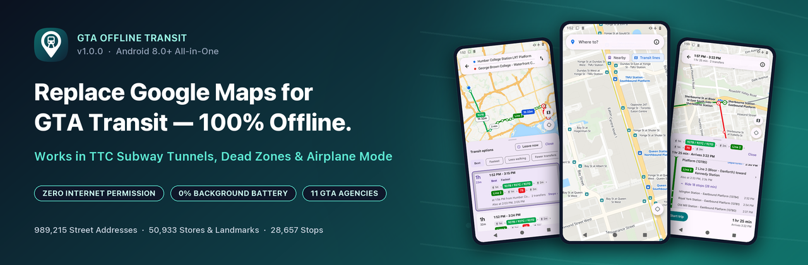
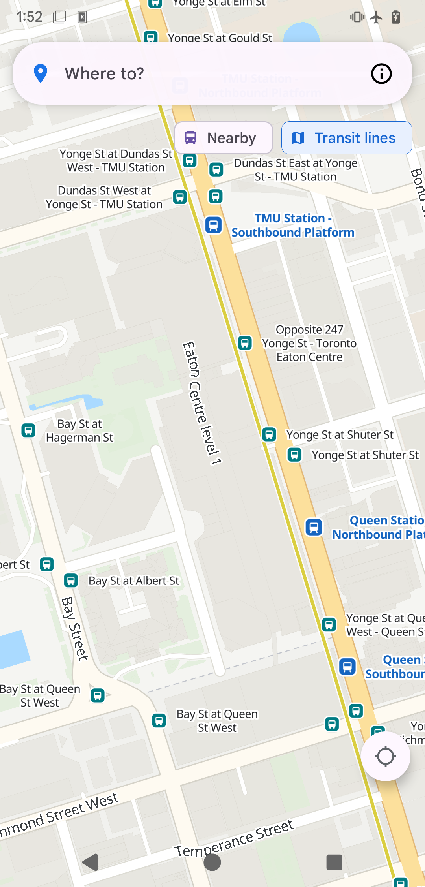
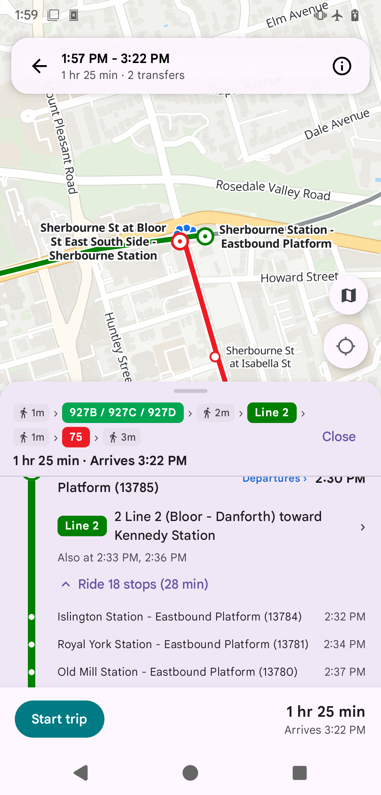
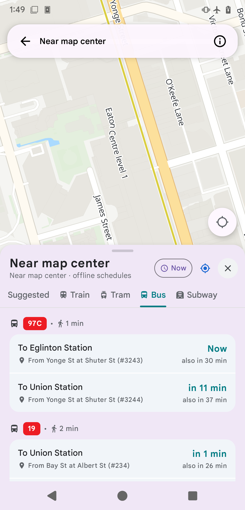
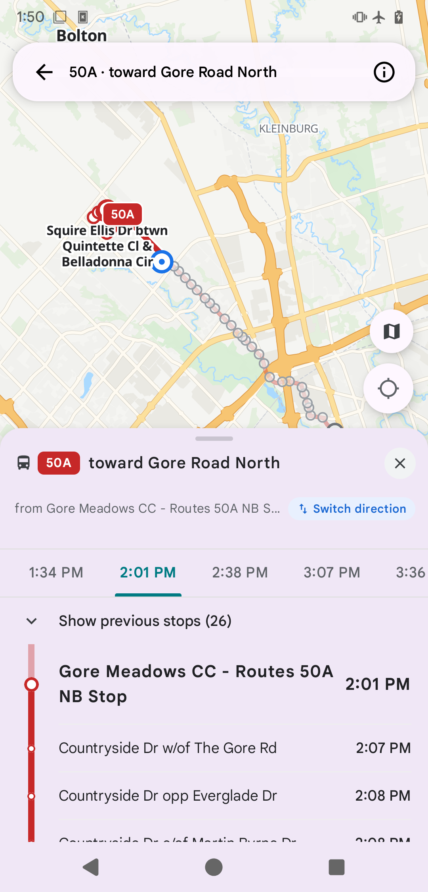
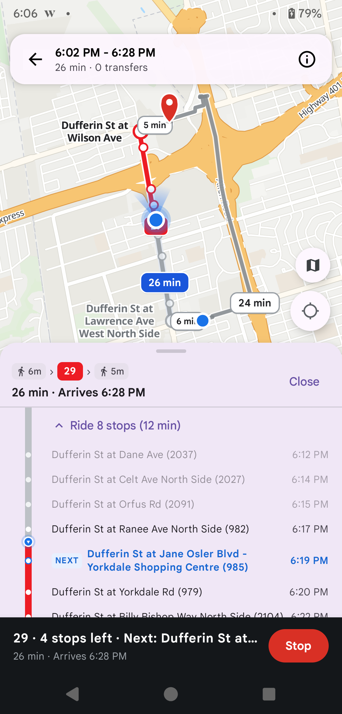
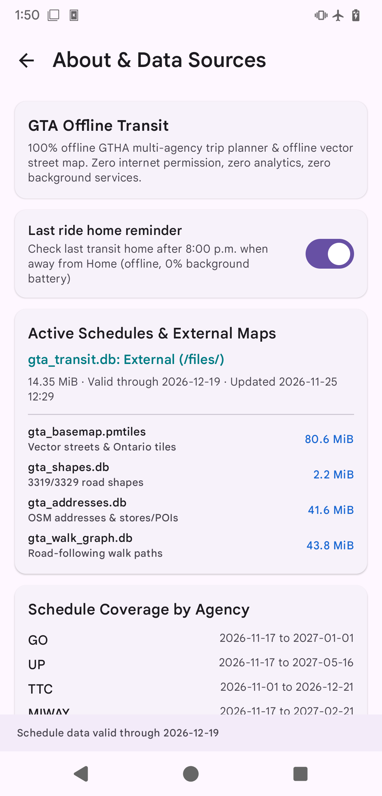

<div align="center">



<br /><br />

<p><b>Google Maps dies in TTC tunnels. This doesn't.</b></p>

<p>The first full Google Maps-style GTA transit planner, vector street map, and address search for Android that runs <b>100% offline</b>—with <b>zero internet permission</b> and <b>0% background battery drain</b>.</p>

<p>
  <a href="https://github.com/Pallavlohan/gta-offline-transit/releases/latest"></a>
  <a href="https://github.com/Pallavlohan/gta-offline-transit/releases"></a>
  <a href="https://github.com/Pallavlohan/gta-offline-transit/releases/latest"></a>
  <a href="#verify-zero-internet-privacy"></a>
</p>

<h3>
  <a href="https://github.com/Pallavlohan/gta-offline-transit/releases/latest">
    ⬇️ Download GTA Offline Transit v1.1.0 (Android APK · 144 MB All-in-One)
  </a>
</h3>

<sub><i>One download. Zero setup. Every GTA street, store &amp; bus schedule works instantly in Airplane Mode.</i></sub>

</div>

---

| 🚇 **Tunnel-Proof Offline** | 🔒 **Mathematically Private** |
|---|---|
| `~327 ms` cold launch · Works in subway tunnels &amp; Airplane Mode | Zero `INTERNET` permission — OS-blocked tracking &amp; telemetry |
| 🔋 **0% Background Battery** | 🗺️ **Full GTHA Inside** |
| Zero background GPS or services (`onPause` stops all sensors) | `11` agencies · `989k` street addresses · `50k` stores &amp; landmarks |

---

## Why Switch from Google Maps / Transit?

| Commuter Need | GTA Offline | Google Maps / Transit |
|---|---|---|
| **TTC subway tunnels & dead zones** | ✅ 100% — maps, search & routing | ❌ Transit routing dies |
| **Internet permission / tracking** | ✅ ZERO `INTERNET` permission | ❌ Telemetry & tracking |
| **Background battery drain** | ✅ 0% — stops on lock | ❌ Bg GPS & push |
| **Street map + 50k stores + 989k addresses offline** | ✅ Built-in (zero downloads) | ❌ No transit offline |
| **Bus branches (`96B`, `927B / 927C`, `50A`) + Nearby** | ✅ Instant (`< 50 ms`) | ⚠️ Needs data |
| **0% battery `"Last Ride Home"` evening alert** | ✅ Local alarm built in | ❌ Not built in |
| **Real-time bus delays / live GPS** | ⚠️ Scheduled GTFS only | ✅ Live online |

---

## Inside the App

<table>
  <tr>
    <td align="center" width="33%">
      <br />
      <b>Offline GTA Street Map</b>
    </td>
    <td align="center" width="33%">
      <br />
      <b>Door-to-Door Branch Routing</b>
    </td>
    <td align="center" width="33%">
      <br />
      <b>Live GPS Rail &amp; Road Walks</b>
    </td>
  </tr>
  <tr>
    <td align="center" width="33%">
      <br />
      <b>5-Tab Nearby Departures</b>
    </td>
    <td align="center" width="33%">
      <br />
      <b>Curved Route &amp; Time Tabs</b>
    </td>
    <td align="center" width="33%">
      <br />
      <b>Offline Store &amp; Multi-Pin Search</b>
    </td>
  </tr>
</table>

<p align="center">
  <br />
  <b>New in v1.1.0: Live Grey Traveled Route &amp; Dimmed Passed Stops</b>
</p>

---

## Built for Daily GTA Commuters

- **Door-to-door offline routing (`Best` / `Fastest` / `Less walking` / `Fewer transfers` + `Leave` / `Arrive` / `Last`):** Covers all **11 GTHA agencies** including **TTC (with Line 5 Eglinton &amp; Line 6 Finch West)**, GO Transit, UP Express, MiWay, Brampton Transit (Züm), YRT (Viva), DRT, Oakville, Burlington, Milton, and HSR (`28,657` stops · `746` routes · `3,329` patterns · `322,507` trips).
- **Familiar Google Maps muscle memory:** Tap any street stop &rarr; Departures &rarr; full curved route map (`99.7%` road-following shapes) with horizontal departure time tabs and exact branch letters (`96B`, `927B / 927C`, `50A`).
- **Find anything offline (`< 50 ms`):** Instant search across **989,215 street addresses** and **50,933 stores &amp; landmarks** (Tim Hortons, Walmart, pharmacies, colleges) with typo tolerance and walkable street paths.
- **Ride hands-free (`v1.1.0`):** Google Maps-style live grey traveled route line and dimmed passed stops behind your GPS dot (loop-safe on out-and-back bus routes), Heading-Up live compass cone, Saved Places, and foreground GPS tracking down the vertical stop rail with a **1-stop exit vibration**.
- **Never miss the last ride home:** Automatic 0%-battery check after 8:00 p.m. when you're &gt;1 km from Home, offering a 1-tap local alarm 10 minutes before you must leave.

---

## Brutally Honest Pros &amp; Cons

| ✅ Best For (Pros) | ⚠️ Honest Trade-Offs (Cons) |
|---|---|
| **Subway &amp; GO commuters** hitting station tunnels and concrete dead zones | **Official scheduled GTFS timetables only** — no live bus delays or short-turns (by design, since there is zero internet permission) |
| **Prepaid or low-data plans** — zero mobile data needed for maps, search, or routing | **Android `8.0+` (`arm64-v8a`) only** — no iOS or 32-bit builds |
| **Privacy purists** — OS-enforced zero network access (`INTERNET` permission absent) | **`~144 MB` (`143.78 MiB`) APK** — the entire GTA vector map, addresses, walk graph, and 11 agency feeds live inside one file (zero extra downloads) |
| **Backup offline phone, visitors &amp; long battery days** — 0% background drain | **Closed-source APK for now** — full manifest permissions and SHA-256 checksums are published below for independent verification |

---

## 3-Step Install (10 Seconds)

1. **Download:** Grab `GTA-Offline-Transit-v1.1.0-arm64.apk` (`143.78 MiB`) from **[Latest Release](https://github.com/Pallavlohan/gta-offline-transit/releases/latest)**.
2. **Install:** Tap the downloaded `.apk` and allow installs from your browser or Files app.
3. **Ride offline:** Open once (~2 sec automatic offline unpack) and plan anywhere in Airplane Mode.

> **Auto-updates for monthly schedules:** Add `https://github.com/Pallavlohan/gta-offline-transit` in **[Obtainium](https://github.com/ImranR98/Obtainium)** to get notified whenever new GTFS schedule packs drop, with signing-certificate verification.

---

## Verify Zero-Internet Privacy

**Zero `INTERNET` permission. Zero `ACCESS_BACKGROUND_LOCATION`. Zero background services.**

Your phone's operating system physically blocks this app from making network connections—it cannot phone home, send analytics, or leak your searches or location.

- `gta_basemap.pmtiles` — GTA vector street map
- `gta_transit.db` — 11 GTHA agency schedules & transfers
- `gta_shapes.db` — 3,319 / 3,329 road-snapped route shapes
- `gta_addresses.db` — 989,215 addresses + 50,933 stores & POIs
- `gta_walk_graph.db` — walkable pedestrian street network

<p align="center">
  
</p>

<details>
<summary><b>Verify APK Permissions &amp; SHA-256 Checksums Yourself (<code>aapt2</code> &amp; <code>apksigner</code>)</b></summary>

```text
$ aapt2 dump permissions GTA-Offline-Transit-v1.1.0-arm64.apk
package: com.gta.offlinetransit
uses-permission: name='android.permission.ACCESS_FINE_LOCATION'
uses-permission: name='android.permission.ACCESS_COARSE_LOCATION'
uses-permission: name='android.permission.VIBRATE'
uses-permission: name='android.permission.POST_NOTIFICATIONS'
uses-permission: name='android.permission.ACCESS_NETWORK_STATE'
uses-permission: name='android.permission.ACCESS_WIFI_STATE'
permission: com.gta.offlinetransit.DYNAMIC_RECEIVER_NOT_EXPORTED_PERMISSION
uses-permission: name='com.gta.offlinetransit.DYNAMIC_RECEIVER_NOT_EXPORTED_PERMISSION'
```

*(Note: `ACCESS_NETWORK_STATE` / `ACCESS_WIFI_STATE` are standard AndroidX/MapLibre library metadata flags; `android.permission.INTERNET`, `ACCESS_BACKGROUND_LOCATION`, `SCHEDULE_EXACT_ALARM`, and `RECEIVE_BOOT_COMPLETED` are explicitly stripped/absent.)*

- **v1.1.0 APK SHA-256:** `1200a3b401befafb018c14abd9096a732522268ce88e0f7db8b20d152ee489e7`
- **Release Certificate SHA-256:** `84b72575610dc24b340a4854f53b24befe0d263ef3f7a1d416e048562004886b`

</details>

---

[Privacy Policy](PRIVACY.md) · [Changelog](CHANGELOG.md) · [Open Data &amp; Map Attributions](LICENSE_DATA_NOTICES.md) · Monthly GTFS updates published on [Releases](https://github.com/Pallavlohan/gta-offline-transit/releases) · Built by **Pallav**
