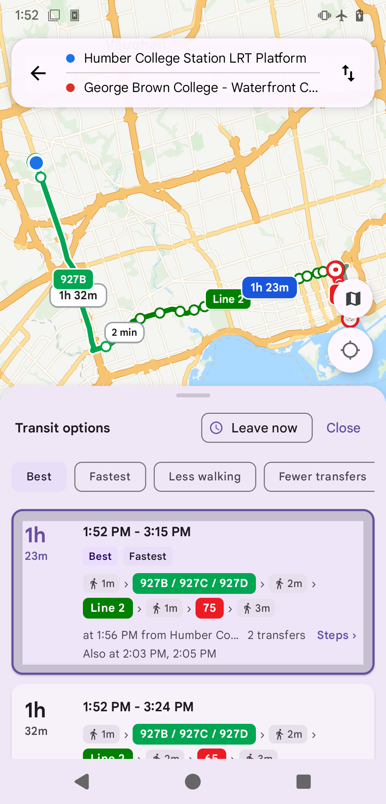
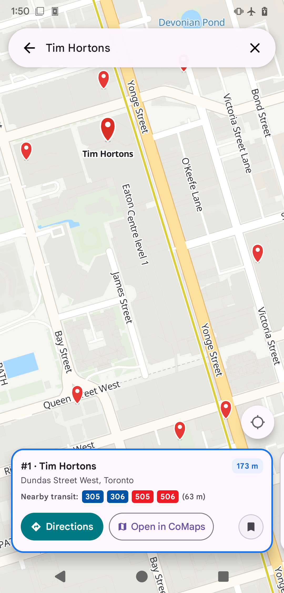

<div align="center">


# GTA Offline Transit

**Offline Toronto, TTC & GO Transit Planner + Street Map for Android — works in subway tunnels, basements, and Airplane Mode with zero internet permission.**

[](https://github.com/Pallavlohan/gta-offline-transit/releases/latest)
[](https://github.com/Pallavlohan/gta-offline-transit/releases)
[-3ddc84?style=for-the-badge&logo=android&logoColor=white)](https://github.com/Pallavlohan/gta-offline-transit/releases/latest)
[-16a34a?style=for-the-badge)](#verifiable-privacy--battery-discipline)

<br />

### [⬇️ Download Latest APK (Android)](https://github.com/Pallavlohan/gta-offline-transit/releases/latest)

*All-in-One APK (`~144 MB` / `143.78 MiB`): bundles the complete GTA vector street map, 989,215 addresses, 50,933 stores & landmarks, walkable street graph, 3,319 road-snapped transit routes, and schedules across all 11 GTHA transit agencies — **zero extra downloads after install.***

</div>

---

## Showcase

<table>
  <tr>
    <td align="center" width="33%">
      <br />
      <b>Offline Street Map &amp; Stops</b><br />
      <sub>Vector buildings, street labels, TTC rail/bus icons &amp; rapid transit backbone</sub>
    </td>
    <td align="center" width="33%">
      <br />
      <b>Door-to-Door Trip Routing</b><br />
      <sub>Stacked durations, branch badges (<code>927B / 927C / 927D</code>), &amp; map pills</sub>
    </td>
    <td align="center" width="33%">
      <br />
      <b>Vertical Rail &amp; Street Walks</b><br />
      <sub>Centered intermediate stop dots &amp; road-following blue dotted walks</sub>
    </td>
  </tr>
  <tr>
    <td align="center" width="33%">
      <br />
      <b>5-Tab Nearby Departures</b><br />
      <sub><code>Suggested | Train | Tram | Bus | Subway</code> with 2-direction cards</sub>
    </td>
    <td align="center" width="33%">
      <br />
      <b>Route Trip Schedules</b><br />
      <sub>Horizontal departure tabs, <code>Show previous stops</code> &amp; full curved route</sub>
    </td>
    <td align="center" width="33%">
      <br />
      <b>Offline Multi-Pin Search</b><br />
      <sub>Search 50k+ stores &amp; franchises with synced cards &amp; nearby transit</sub>
    </td>
  </tr>
  <tr>
    <td align="center" colspan="3">
      <br />
      <b>All-Offline Databases &amp; 0%-Battery Controls</b><br />
      <sub>5 self-contained offline databases, 11 agency windows, &amp; Last ride home reminder</sub>
    </td>
  </tr>
</table>

---

## Why GTA Commuters Use It

- **Works Underground & In Airplane Mode:** Instant offline door-to-door RAPTOR routing (`Best` / `Fastest` / `Less walking` / `Fewer transfers`), `Leave` / `Arrive` / `Last` trip wheel picker, and `"Also at ..."` upcoming departures — zero data connection required.
- **11 GTHA Agencies in One Place:** **TTC** (including Line 5 Eglinton & Line 6 Finch West LRT), **GO Transit**, **UP Express**, **MiWay**, **Brampton Transit (Züm)**, **YRT (Viva)**, **Durham Region Transit (DRT)**, **Oakville Transit**, **Burlington Transit**, **Milton Transit**, and **HSR** — preserving real branch letters (`96B`, `927B / 927D`, `50A`).
- **Familiar Google Maps Feel, Offline Superpowers:**
  - 5-tab **Nearby Departures** (`Suggested | Train | Tram | Bus | Subway`) with 2-direction grouped cards & GO/Subway station boards.
  - Tap-through **Stop Departures** & full curved **Route Schedules** with horizontal scrollable departure time tabs, `"Show previous stops"`, and `"Switch direction"`.
  - Offline search across **989,215 addresses** (with even/odd parity interpolation) and **50,933 stores, franchises, pharmacies, & landmarks** with typo tolerance and multi-pin map carousels.
  - Road-following **dotted pedestrian walks**, **Heading-Up** live compass cone, foreground-only **live GPS stop-rail tracking** with 1-stop exit vibration, **Saved Places** (`Home`, `Work`, `Favorites`, `Want to go`, starred stops), and 0%-battery **"Last ride home"** evening reminder.

## Verifiable Privacy & Battery Discipline

Zero `INTERNET` permission, zero `ACCESS_BACKGROUND_LOCATION`, zero analytics, and zero background services — your app literally cannot phone home.

<details>
<summary><b>Verify Permissions &amp; Checksums Yourself (<code>aapt2</code> &amp; <code>apksigner</code> output)</b></summary>

```text
$ aapt2 dump permissions GTA-Offline-Transit-v1.0.0-arm64.apk
package: com.gta.offlinetransit
uses-permission: name='android.permission.ACCESS_FINE_LOCATION'
uses-permission: name='android.permission.ACCESS_COARSE_LOCATION'
uses-permission: name='android.permission.VIBRATE'
uses-permission: name='android.permission.POST_NOTIFICATIONS'
uses-permission: name='android.permission.ACCESS_NETWORK_STATE'
uses-permission: name='android.permission.ACCESS_WIFI_STATE'
permission: com.gta.offlinetransit.DYNAMIC_RECEIVER_NOT_EXPORTED_PERMISSION
uses-permission: name='com.gta.offlinetransit.DYNAMIC_RECEIVER_NOT_EXPORTED_PERMISSION'
```

*(Note: `ACCESS_NETWORK_STATE` / `ACCESS_WIFI_STATE` are AndroidX/MapLibre library metadata flags; `android.permission.INTERNET`, `ACCESS_BACKGROUND_LOCATION`, `SCHEDULE_EXACT_ALARM`, and `RECEIVE_BOOT_COMPLETED` are explicitly stripped/absent.)*

- **v1.0.0 APK SHA-256:** `c88e0c4a8dccdfaccf7d0a2dde621b6c133cf7f0cb02e62803346e33eca2d080`
- **Release Certificate SHA-256:** `84b72575610dc24b340a4854f53b24befe0d263ef3f7a1d416e048562004886b`

</details>

---

## 3-Step Install Guide

1. **Download `.apk`:** Tap **[Download Latest APK](https://github.com/Pallavlohan/gta-offline-transit/releases/latest)** and download `GTA-Offline-Transit-v1.0.0-arm64.apk` (`143.78 MiB`).
2. **Allow install from browser:** Open the downloaded file in Android and allow installing apps from your browser/files app when prompted.
3. **Open & ride:** Launch **GTA Offline Transit** — first run unpacks the bundled offline map & search databases (~0.5 seconds), and you're ready to plan anywhere offline!

> **Tip — Automatic Monthly Schedule Updates via [Obtainium](https://github.com/ImranR98/Obtainium):**
> Add `https://github.com/Pallavlohan/gta-offline-transit` in Obtainium to get instant notifications whenever a monthly schedule release drops, with signing-certificate verification built in.

---

## Monthly Schedule Updates

Transit schedules across the 11 GTHA agencies change seasonally and monthly. Updated standalone releases are published on the [Releases](https://github.com/Pallavlohan/gta-offline-transit/releases) page with automated per-agency schedule coverage deltas (`valid through` dates, route/pattern/trip changes) and `SHA256SUMS.txt` checksums.

See [CHANGELOG.md](CHANGELOG.md) for release history and [PRIVACY.md](PRIVACY.md) for the full technical permission breakdown.

---

## Open Data & Map Attributions

- **Offline Map Tiles & Vector Style:** Map tiles generated with [Planetiler](https://github.com/onthegomap/planetiler) using the OpenMapTiles schema from © [OpenStreetMap](https://www.openstreetmap.org/copyright) contributors (**ODbL**); rendered offline with [MapLibre Native](https://maplibre.org/).
- **Offline Address & POI Search / Walk Graph:** Addresses, places, and walkable street network © [OpenStreetMap](https://www.openstreetmap.org/copyright) contributors (**ODbL**).
- **Transit Schedules & Shapes (11 GTHA Agencies):**
  - **GO Transit & UP Express:** Contains public sector information licensed under the Open Government Licence – Ontario – Metrolinx.
  - **TTC (Toronto Transit Commission):** Contains information licensed under the Open Government Licence – Toronto.
  - **MiWay (City of Mississauga):** Contains information licensed under the Open Government Licence – City of Mississauga.
  - **Brampton Transit (City of Brampton):** Contains data provided by the City of Brampton under Creative Commons Attribution 4.0 International (CC BY 4.0).
  - **Durham Region Transit (DRT):** Contains public sector information made available under The Regional Municipality of Durham's Open Data Licence.
  - **York Region Transit (YRT / Viva):** Contains public transit information made available under YRT's Open Data Licence.
  - **Oakville Transit:** Contains information licensed under the Open Government Licence – Town of Oakville.
  - **Burlington Transit:** Contains information licensed under the Open Government Licence – City of Burlington.
  - **Milton Transit:** Contains public transit schedule data made available via Metrolinx / Milton Transit open data.
  - **Hamilton Street Railway (HSR):** Contains public sector data made available under the City of Hamilton's Open Data Licence.

Full licence notices are included in [LICENSE_DATA_NOTICES.md](LICENSE_DATA_NOTICES.md).

---

<sub>Maintained by **Pallav** · 100% offline Android transit & maps for Toronto and the GTHA.</sub>
